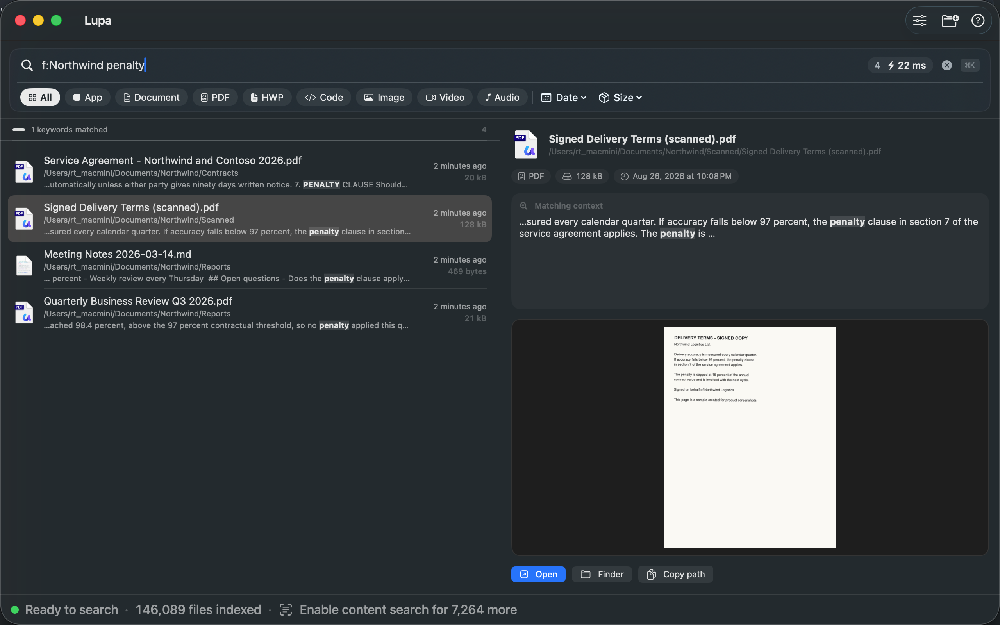

# Lupa — 잊기 전에 찾는다

**문서 속에 적힌 내용으로 Mac의 파일을 찾습니다. AI 에이전트도 똑같이 찾습니다.**

[](https://apps.apple.com/kr/app/id6789231809)

무료 · macOS 14 이상 · 완전 로컬 · [lupa.kr](https://lupa.kr) · [English](README.md)



> 이 저장소는 Lupa의 공개 안내 공간입니다 — 설명서, 릴리스 노트, 건의·버그 접수(Issues).
> **앱의 소스 코드는 들어 있지 않습니다.** 앱은 Mac App Store에서 받으세요.

## 무엇을 하나

- **문서 안의 글자로 찾습니다** — PDF, 워드, 엑셀, 파워포인트, 한글(HWP/HWPX), 텍스트·마크다운, 코드, 스캔 PDF와 스크린샷 속 글자(기기 내 OCR).
- **여러 단어를 넣으면 모두 맞는 파일이 먼저** 나옵니다.
- **검색 조건** — `f:폴더` `c:내용` `n:이름` `-제외` `"정확한 구문"` `.pdf` `종류:PDF` `크기:>10mb` `날짜:7일`
- **한국어 처리** — 합성어 속 단어(`보호정책` → `정보보호정책서`)와 조사(`심사보고서를` → `심사보고서`)를 알아듣습니다.

## AI 에이전트와 함께

Lupa에는 명령줄 도구와 [MCP 서버](https://github.com/under71/lupa-mcp)가 있어서, Claude Code·Claude Desktop 등 MCP를 지원하는 도구가 Lupa의 색인으로 문서를 찾습니다 — **파일을 직접 열지 않고**.

- 앱의 **설정 ▸ 일반**에서 한 번에 연결
- 직접 등록: `npx -y lupa-mcp`
- Claude Code 플러그인: [lupa-claude-plugin](https://github.com/under71/lupa-claude-plugin)
- 도구별 설정 방법: **[lupa.kr/agents.html](https://lupa.kr/agents.html)**

## 개인정보 — 직접 확인할 수 있습니다

Lupa에는 **네트워크 권한이 없습니다.** 터미널에서 이렇게 확인하세요.

```bash
codesign -d --entitlements - /Applications/Lupa.app
```

아래 네 가지만 나오고, 네트워크 권한(`com.apple.security.network.client`)은 없습니다.

```
com.apple.security.app-sandbox
com.apple.security.application-groups
com.apple.security.files.bookmarks.app-scope
com.apple.security.files.user-selected.read-write
```

동봉된 명령줄 도구는 두 가지(`app-sandbox`, `application-groups`)뿐입니다 — Lupa의 색인만 읽고 문서는 열지 않습니다.
App Store 개인정보 라벨: **데이터를 수집하지 않음**.

## 건의·문의

- **버그·기능 건의** → [Issue 남기기](https://github.com/under71/lupa/issues/new/choose) (한국어 환영)
- **보안 문제** → [SECURITY.md](SECURITY.md) (공개 게시판에 올리지 말아 주세요)
- 메일: lupa.app.kr@gmail.com

## 릴리스

[RELEASE_NOTES.md](RELEASE_NOTES.md)

---

© 2026 Paeyoung Park. All rights reserved. Lupa는 Mac App Store에서 무료이며 소스 코드는 공개하지 않습니다. 특허 출원 중(KR).
