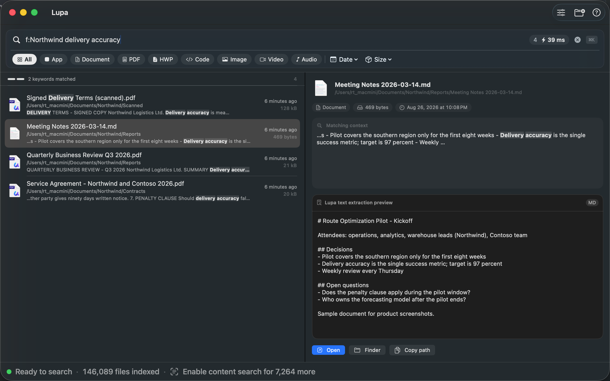
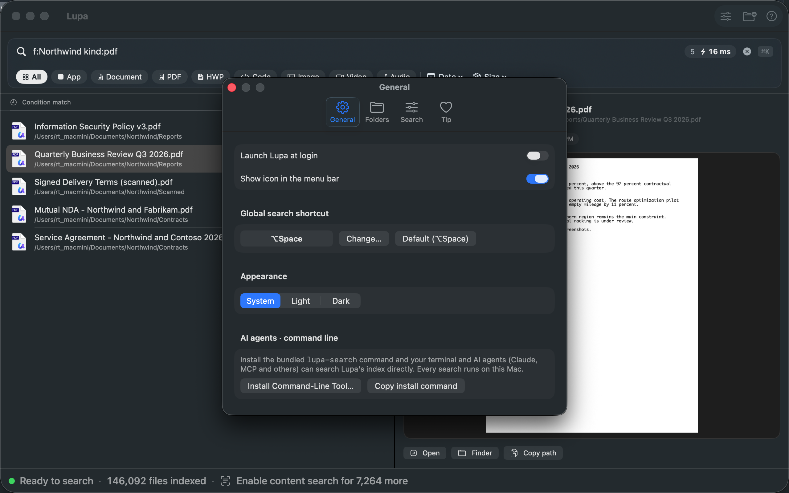

# Lupa — Find it before you forget it

**Search your Mac by what's written inside your documents — and let your AI agent do the same.**

[](https://apps.apple.com/app/id6789231809)

Free · macOS 14+ · Fully local · [lupa.kr](https://lupa.kr) · [한국어](README.ko.md)


> This repository is Lupa's public home: documentation, release notes and the issue tracker.
> **It does not contain the app's source code.** Get the app from the Mac App Store.

## What it does

- **Search inside documents**, not just file names — PDF, Word, Excel, PowerPoint, Hangul (HWP/HWPX), plain text and Markdown, source code, and scanned PDFs and screenshots via on-device OCR.
- **Many words, best match first** — files that match every word rank on top.
- **Search conditions** — `f:folder`, `c:content`, `n:name`, `-exclude`, `"exact phrase"`, `.pdf`, `kind:pdf`, `size:>10mb`, `date:week`.
- **Korean-aware** — finds words inside compounds and ignores attached particles.



## Your AI agent can use it

Lupa ships with a command-line tool and an [MCP server](https://github.com/under71/lupa-mcp), so agents such as Claude Code, Claude Desktop and other MCP-capable tools can search your documents through Lupa's index — **without opening your files**.

- One-click setup: **Settings ▸ General** in the app
- Or register the MCP server yourself: `npx -y lupa-mcp`
- Claude Code plugin: [lupa-claude-plugin](https://github.com/under71/lupa-claude-plugin)
- Setup guide for each tool: **[lupa.kr/agents.html](https://lupa.kr/en/agents.html)**



## Privacy you can check yourself

Lupa has **no network permission**. You don't have to take our word for it — run this in Terminal:

```bash
codesign -d --entitlements - /Applications/Lupa.app
```

You'll see only these four entitlements, and no `com.apple.security.network.client`:

```
com.apple.security.app-sandbox
com.apple.security.application-groups
com.apple.security.files.bookmarks.app-scope
com.apple.security.files.user-selected.read-write
```

The bundled command-line tool has just two (`app-sandbox`, `application-groups`) — it reads Lupa's index, never your documents.
App Store privacy label: **Data Not Collected**.

## Feedback

- **Bug or feature request** → [open an issue](https://github.com/under71/lupa/issues/new/choose) (Korean or English is fine)
- **Security issue** → see [SECURITY.md](SECURITY.md) — please don't post it publicly
- Email: lupa.app.kr@gmail.com

## Releases

See [RELEASE_NOTES.md](RELEASE_NOTES.md).

---

© 2026 Paeyoung Park. All rights reserved. Lupa is free on the Mac App Store; its source code is not published. Patent pending (KR).
